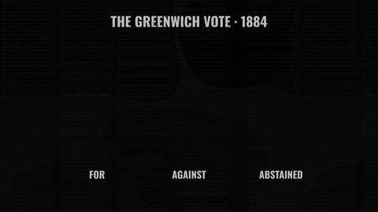
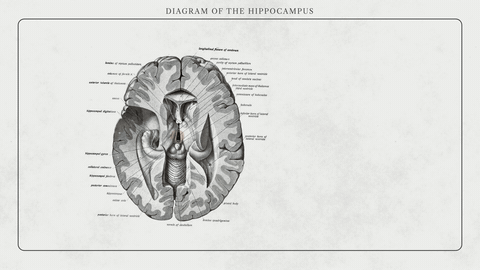
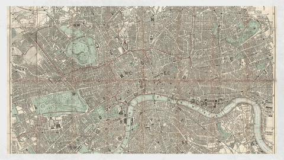

# Getting started

From nothing to your first Vox-style video, in Claude Code. You install the skills once, then describe the video in a
prompt. Ready-made prompts are in [examples/](examples/).


## 1 · Install the skills

In Claude Code:

```
/plugin marketplace add ilomon10/vox-style-animation
/plugin install vox-studio@vox-style-animation
```

On first use the skills download this framework into `./vox-studio` (or into the folder in `$VOX_STUDIO_HOME`) and set it
up. Setup installs the packages, a small scratch-voice model and the starter assets, and takes a few minutes. You don't
download any pictures, sounds or music yourself: the framework fetches them from free-licence sources as a video needs
them.

**What your computer needs:**
- Node.js 18+, Python 3.10+, FFmpeg, ImageMagick 7 and git;
- Linux or macOS (on Windows, use WSL2);
- about 2 GB of disk, plus your renders.

If something is missing, setup prints the install command for your system.

<details><summary>Prefer to clone it yourself?</summary>

```bash
git clone https://github.com/ilomon10/vox-style-animation
cd vox-style-animation
bash tools/setup.sh
claude                       # the skills load automatically inside the checkout
```
</details>

## 2 · Make your first video

Paste a starter prompt. This one makes the video at the top of the page:

```text
Make a 30-second Vox-style explainer: "Why railroads gave America time zones".
Look: voxEarworm. Pictures from the shared free-licence catalog, a calm music bed, one page-flip sound.
Build it from these blocks, in order:
1. Hook: [block: cold-open-year] 1883, the United States; two archival pictures (a telegraph van, a river flatboat).
2. The problem: [block: keyword-cut] NOON over a busy street photo, with "NEW YORK · PHILADELPHIA" under it.
3. The number: [block: giant-word-card] "56 TIMES" with a small locomotive photo.
4. The change: [block: map-route] the US time zones; route New York → Chicago → Denver → San Francisco; label "4 ZONES", "NOV 18 · 1883".
5. The world: [block: keyword-cut] GREENWICH over the Earth from space, with "WASHINGTON · 1884" under it.
6. The law: [block: giant-word-card] "1918".
7. Ending: [block: end-card] our series "TIME DESK", tagline "A KIT EXAMPLE".
```

What Claude does next:
1. **Checks the setup** and fixes what it can.
2. **Researches the topic.** Every fact goes into `video-projects/<name>/RESEARCH.md` with its source.
3. **Directs it with you.** At each step it says where the video stands, recommends an answer, and asks (see
   [Director mode](#director-mode-it-asks-you-recommends-and-steps-back-when-you-say-so) below): the angle, a block
   per section, the script, the voice, what to do where something is missing, the music, and how the draft looks.
4. **Builds the video:**
   - a scratch voice-over;
   - pictures, music and sound effects from the free catalog;
   - a storyboard with one scene per block;
   - a draft render.
5. **Hands over:**
   - the draft in `out/studio/<name>.mp4`;
   - `CREDITS.md`, with the attribution lines to paste into your video description;
   - a recording guide for your own voice.

Your video will not match the preview frame for frame. The research, the wording and the pictures can differ. The
blocks fix the structure.

### Director mode: it asks you, recommends, and steps back when you say so

By default Claude makes the video **with** you. At each checkpoint it shows where the video stands, puts its
recommendation first, and asks one short set of questions. In Claude Code they appear as clickable choices, and a
layout choice comes with a small text preview of the scene. Pick one, type your own answer, or say:

| Say | And Claude |
|---|---|
| **"autopilot"**, "stop asking", "just make it" | decides everything from here with its recommendations, and lists each decision in `HANDOFF.md` |
| "only the big decisions" | asks only about the brief, the script and the final look |
| "guide me" | goes back to asking at every step |

Start in autopilot straight away: `/vox-studio:vox-video autopilot: why do we have leap years?`

**When you don't have something,** Claude recommends what to use instead:
- **No picture** for a section: a catalog picture, then a public-domain one from the web, then a block that needs no
  picture (a giant word, a counter, a quote card), or a map when the line is about a place.
- **No portrait** of a person: never a look-alike. It uses their words on a quote card, or their name over a place.
- **No voice:** a synthetic scratch voice for the draft, with a guide for recording yours later.
- **No music:** a bed from the free catalog, or a generated one.
- **No series name:** three suggestions from your topic.

**Previews while you decide:**

| Preview | Command (Claude runs it for you) | What you see |
|---|---|---|
| The board | `tools/py tools/studio/board.py <name> --open` | one page with a card per section: its picture (a frame of the draft, or the block's sketch), narration, assets and anything missing |
| Voices | `tools/py tools/voice/voice_samples.py --slug <name> --open` | your first sentence in seven scratch voices, one player each |
| Live preview | `npm run studio` | the video in Remotion Studio at http://localhost:3000: scrub, play, with sound |
| Where it stands | `tools/py tools/studio/director.py <name>` | each section's block, timing and narration, what's missing, and the next step |

**Where it works:**

| You use | Questions | Previews |
|---|---|---|
| Claude Code in a terminal | clickable choices | the board opens in your browser |
| Claude Code desktop app | the skill falls back to a numbered list if your version shows no choices | click the board's path and it opens in the app's Browser pane |
| Claude Code on the web, VS Code | clickable choices | the board as a file to open |
| Claude chat (claude.ai) | clickable options where the app offers them | planning only: see [Plan in Claude chat](#plan-in-claude-chat) |

## 3 · Make it yours

Keep the shape of a starter and change the topic, or start from the template in
[examples/README.md](examples/README.md#write-your-own). Each line of the request is one section of the video, and the
`[block: …]` tag says what that section looks like:

| | |
|---|---|
| <br>`[block: cold-open-year]`: open on a year | <br>`[block: map-route]`: a route across a map |
| <br>`[block: document-highlight]`: a document, highlighted and ringed | <br>`[block: data-bars]`: numbers side by side |
| <br>`[block: specimen-plate]`: a diagram with a magnifier and "fig." labels (scrapbook look) | <br>`[block: torn-paper-stat]`: a number on torn paper (scrapbook look) |

All 21 blocks, each with a prompt template and the scene it produced: **[the block gallery](examples/README.md#blocks)**.
They come in two collections, one per look: the Earworm collage (the default) and the scientific scrapbook
(`Look: voxScrapbook`; its starter is [cab-brain](examples/starters/cab-brain.md)). Build a video from one collection.

You can also use a block on its own, in a video you already have:

```text
In the fourth section, use [block: document-highlight]: show the 1883 railway time map and ring the four zone clocks as they are named.
```

**The rules Claude keeps:**
- **Facts:** they come only from its research, with a source each. A number or a quote you put in a block line is
  checked like any other claim, and anything it can't confirm is flagged.
- **Pictures:** they are public domain or CC0, every one with a credit line.
- **Branding:** it never uses Vox's or any other channel's logo or wordmark. Your series name is your own.

## Plan in Claude chat

Claude chat can't render video: rendering needs the framework on your computer. It can still plan the whole video with
you, and hand over files that render in Claude Code.

1. In claude.ai, turn on code execution (**Settings → Capabilities**).
2. Download `vox-director.zip` from the repository's
   [latest release](https://github.com/ilomon10/vox-style-animation/releases/latest), or build it with
   `npm run chat-skill`.
3. Upload it: **Customize → Skills → + → Upload a skill**.
4. Ask: *"Plan a Vox-style video about why we have leap years."* Claude directs it the same way: brief, research with
   sources, angle, a block per section, script, music, storyboard. It shows you a board with a sketch of each section.
5. You get a project pack: `script.md`, `RESEARCH.md`, `storyboard.json`, `CREDITS.md`, the board and a hand-off note.
   Put the folder in the framework's `video-projects/`, open Claude Code there and say *"Build the video project
   video-projects/&lt;name&gt;"*.

## 4 · Record your voice

The draft uses a synthetic scratch voice. Read `RECORDING_GUIDE.md` (the script, with marks for stress and pauses),
record yourself, and give Claude the WAV file: *"Here is my recording: video-projects/&lt;name&gt;/audio/vo_user.wav"*.
It re-times every scene to your voice and renders the final video, in 1080p or 4K.

## 5 · Optional: make it look like your reference

Attach a video, a link, style frames or a PDF and say *"make it look like this"*. The reference stays private. Claude
studies its colours, pacing and type, and cuts its pieces into your project: backgrounds, props, marks and sound
effects. See the [`vox-reference` skill](.claude/skills/vox-reference/SKILL.md).

## Where things are

| What | Where |
|---|---|
| Your project (script, research, storyboard, credits) | `video-projects/<name>/` |
| Renders | `out/studio/<name>.mp4` |
| Prompts to copy | [`examples/`](examples/) |
| The free asset catalog | [`public/assets/library/CATALOG.md`](public/assets/library/CATALOG.md) |
| The style guide | [`docs/style-guide/`](docs/style-guide/README.md) |

## If something goes wrong

- **Check the setup:** run `tools/py tools/doctor.py` to see what's wrong, and `bash tools/setup.sh` to fix it. It is
  safe to run again.
- **A download fails with HTTP 429** (the site is busy or rate-limiting): try again later, using the command fetch
  prints. Wikimedia asks automated clients for a contact; set `VOX_UA_CONTACT=<your URL or e-mail>` if you want to
  send one. Nothing is sent unless you set it.
- **Licensing:** Remotion is free for individuals, non-profits and companies of up to 3 people. Larger companies need a
  company licence: <https://www.remotion.dev/license>.
