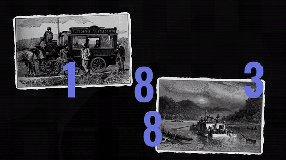
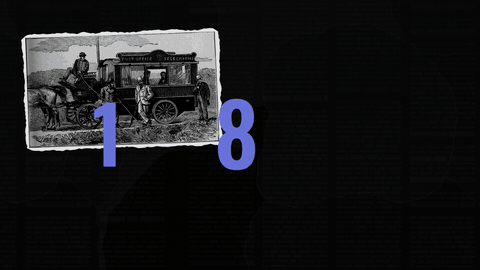
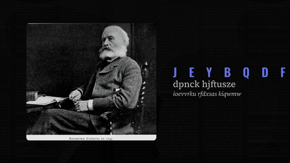
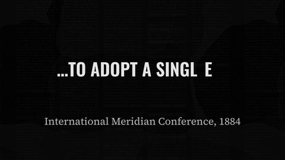
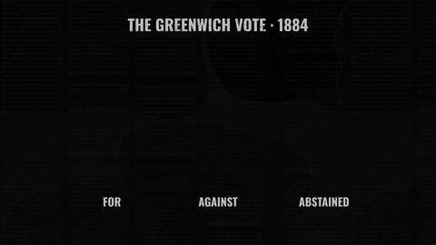
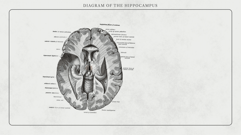

# Vox-style animation framework

Make Vox-style explainer videos with Claude Code: a one-line idea becomes a researched script, a scratch voice-over,
a storyboard of animated collage scenes and a rendered video, re-timed to your own voice when you record it.

- **A measured style guide.** Colour, type, layout, motion, transitions and sound are measured frame by frame on real
  Vox videos (`docs/style-guide/`, evidence in `analysis/`).
- **A Remotion (React/TypeScript) kit.** It has six looks, paper and collage effects, camera rigs, transitions, audio
  sync, a storyboard engine and scene recipes (`src/`).
- **A free asset catalog.** Public-domain and CC0 photos, engravings, documents, maps, cut-outs, textures, hand-drawn
  marks, sound effects, music beds and footage, downloaded on demand (`public/assets/library/`).
- **Your own references.** Attach a video or style frames, and its backgrounds, props, marks, type and sound effects
  become assets for your project.

> Independent project, **not affiliated with Vox Media**. It ships no Vox footage, frames, audio or logos: see [NOTICE.md](NOTICE.md).

## Getting started



1. **Install the skills** in Claude Code:
   ```
   /plugin marketplace add ilomon10/vox-style-animation
   /plugin install vox-studio@vox-style-animation
   ```
2. **Paste a prompt** from [examples/](examples/README.md). A starter makes a whole video. A `[block: …]` line decides
   what one section looks like: a cold open on a year, a route on a map, a highlighted document, a bar chart.
3. **Decide with Claude, or let it drive.** Claude researches the topic, then directs the video with you: at each step
   it recommends an answer and asks (angle, blocks, script, voice, music, the look), with previews such as a
   storyboard board, voice samples and a live preview. Say **"autopilot"** at any time and it decides the rest. You get
   a draft render with a scratch voice; record your own and the video re-times to it.

| | | |
|---|---|---|
| <br>`cold-open-year` | <br>`map-route` | <br>`document-highlight` |
| <br>`name-card` | <br>`quote-card` | <br>`data-bars` |
| <br>`specimen-plate` | <br>`torn-paper-chapter-card` | <br>`stamped-stat` |

**Step by step: [GETTING_STARTED.md](GETTING_STARTED.md). All prompts and blocks: [the gallery](examples/README.md).
Planning in Claude chat: [the `vox-director` skill](GETTING_STARTED.md#plan-in-claude-chat).**

## Install

**Option A: install the skills (Claude Code plugin).**

```
/plugin marketplace add ilomon10/vox-style-animation
/plugin install vox-studio@vox-style-animation
```

Then ask, for example: *"Make a 90-second Vox-style explainer about why we have time zones."* On first use, the skill
clones this repository into `./vox-studio` (or `$VOX_STUDIO_HOME`) and runs its setup.

**Option B: clone it.**

```bash
git clone https://github.com/ilomon10/vox-style-animation
cd vox-style-animation
bash tools/setup.sh          # checks prerequisites, installs packages, the voice model and the kit assets
claude                       # the project skills load automatically
```

**What it needs:**
- Node.js 18+, Python 3.10+, FFmpeg, ImageMagick 7 and git;
- about 2 GB of disk, plus renders;
- Linux or macOS. On Windows, use WSL2.

`bash tools/setup.sh --check` lists what is missing and how to install it; `--no-voice` skips the 354 MB scratch-voice
model. Run `tools/py tools/doctor.py` at any time to check the setup.

**Remotion's licence.** Remotion is free for individuals, non-profits and companies of up to 3 people. Larger
companies need a company licence: <https://www.remotion.dev/license>.

## The skills

| Skill | Say something like | It does |
|---|---|---|
| [`vox-video`](.claude/skills/vox-video/SKILL.md) | "Make a Vox-style video about …", or hand back your recording | research with sources → script (you approve it) → scratch voice-over + recording guide → licensed assets → music and SFX → storyboard → render → QA → re-time to your voice |
| [`vox-reference`](.claude/skills/vox-reference/SKILL.md) | "Make it look like this" + a video, URL, style frames or PDF | ingests the reference privately, scans it (contact sheets, palette, pacing, words), cuts its pieces into your project, notes its style |
| [`vox-assets`](.claude/skills/vox-assets/SKILL.md) | "Find me an old map of …", "collect more assets" | searches the catalog, downloads on demand, sources more from the web with licence checks, adds good finds to the catalog |

## Quick start

```bash
npm run studio               # browse the kit: galleries, proof shots, storyboard projects
npm run example              # build and render the example video (video-projects/example-time-zones)
tools/py tools/library/search.py "telephone operators" --fetch     # find and download catalog assets
tools/remotion-locked.sh render src/index.ts StoryboardVideo out/studio/<slug>.mp4 --props='{"project":"<slug>"}'
```

All Remotion commands go through `tools/remotion-locked.sh`. It runs one render at a time, with the concurrency setup
chose for your machine (`tools/local.env`). For 4K, add `--scale=2`. All Python goes through `tools/py`, the project venv.

## How a video is made

The full pipeline is in [doc 14](docs/style-guide/14-production-pipeline.md). Story and script rules are in
[doc 13](docs/style-guide/13-story-to-screen.md).

1. **Research and script.** Facts are researched with sources (`RESEARCH.md`); nothing is invented. The script follows
   the Vox pattern, and you approve it.
2. **Voice.** A scratch voice-over (local Kokoro TTS) sets the timing. `RECORDING_GUIDE.md` helps you record your own read.
3. **Images.** Sources come in this order:
   1. your files;
   2. pieces cut from your reference;
   3. the shared catalog;
   4. the web: public domain, CC0, CC BY/BY-SA and US-government works, never news agencies.

   Every file is credited in `CREDITS.md`.
4. **Music and SFX.** Catalog beds come first, then free-licence libraries. If nothing fits, a procedural bed is used,
   with `MUSIC_WANTED.md` describing what to look for.
5. **Edit.** `storyboard.json` lists scene recipes anchored to spoken words. Then validate → publish → render → QA.
6. **Final.** You record the voice-over. `tools/py tools/studio/recue.py` re-times the whole edit to it, and the video
   renders again.

Each video lives in `video-projects/<slug>/`. Git keeps its text: script, storyboard, research, credits. Voices, music
and downloads are rebuilt locally.

## Your own reference → assets

```bash
tools/py tools/reference/ingest.py <slug> my_reference.mp4 --rights own     # or a folder of images, a PDF, a URL
tools/py tools/reference/scan.py <slug> ref1                                # contact sheets, palette, pacing, words
# fill reference/ref1/assets.manifest.json (template: tools/reference/manifest.template.json), then:
tools/py tools/assets/extract_assets.py --manifest video-projects/<slug>/reference/ref1/assets.manifest.json
```

The pieces land in `video-projects/<slug>/assets/ref/ref1/`, with a catalog, provenance notes and contact sheets.
Everything from a reference stays on your machine (git-ignored). Pieces from a reference you do not own are for drafts:
the validator warns about them, and the hand-off lists a replacement for each. Details are in
[tools/reference/README.md](tools/reference/README.md).

## The asset catalog

Git holds only `public/assets/library/catalog.json`. Each entry records its source, licence evidence, processing steps
and checksum.
- `tools/library/fetch.py` downloads files from their original sites, verifies them and puts them in place.
- Generated assets (papers, grain, dust, marks, maps, SFX) are rebuilt from fixed seeds.
- Images are public domain or CC0. Some music is CC BY: its attribution lines are in
  [CREDITS.md](public/assets/library/CREDITS.md).
- Browse it in [CATALOG.md](public/assets/library/CATALOG.md). Gaps to fill are in [WANTED.md](public/assets/library/WANTED.md).

## Repository map

| Where | What |
|---|---|
| [`examples/`](examples/README.md) | prompts to copy: starter requests and the block gallery, with GIF previews |
| [`docs/style-guide/`](docs/style-guide/README.md) | the rules, every number measured from the references (start here) |
| `.claude/skills/` | the canonical skills (`vox-video`, `vox-reference`, `vox-assets`) |
| `plugin/`, `.claude-plugin/` | the Claude Code plugin (`vox-studio`) and its marketplace: launchers that install the framework and follow the canonical skills |
| `src/` | the kit:<br>• tokens, effects, collage, camera/motion, transitions, type, annotations<br>• audio sync (`src/audio`)<br>• the Earworm look (`src/earworm`) and the scrapbook look (`src/scrapbook`)<br>• the storyboard engine (`src/studio`) and its recipes (`src/recipes`)<br>• proof shots, galleries |
| `tools/` | • `setup.sh`, `doctor.py`, `py`, `remotion-locked.sh`<br>• `library/`: catalog, fetch, search, add, marks, maps<br>• `reference/`: ingest, scan<br>• `assets/`: extract, cut-outs<br>• `studio/`: new project, validate, publish, re-time<br>• `examples/`: build an example, make the gallery<br>• `voice/`, `source/`, `audio/`, `analysis/`, `textures/`<br>• `dev/release_audit.py` |
| `video-projects/` | one folder per video (the examples: `example-time-zones/`, `example-world-time/`, `example-cab-brain/`) |
| `analysis/` | the evidence: frame-by-frame reports of the reference videos, metrics, shot tables, palettes |
| `public/` | where Remotion reads media. Here git keeps only the catalog and README files: everything else is fetched or generated (the only media in git are the gallery previews in `examples/`) |

## Studying references (the evidence)

The style guide was measured on reference videos that are **not** in this repository. They are copyrighted, so
`reference/` and everything derived from them stays private. To re-run the measurements on videos you are entitled to
use:

```bash
tools/py tools/source/fetch_reference.py <youtube-id>=<analysis_id> --style <tag>   # private download, registered for analysis
tools/analysis/preprocess_long.sh <analysis_id>                                      # metrics, shots, sheets, audio, palette
tools/py tools/analysis/compare.py <id@sec> <render.png>                             # style-match QA
```

Audio sync rules are in [doc 11](docs/style-guide/11-audio-sync.md).

## Licences

- **Code:** MIT ([LICENSE](LICENSE)).
- **Docs, style guide, analysis text and skills:** CC BY 4.0 ([LICENSE-docs.md](LICENSE-docs.md)).
- **Generated assets:** CC0.
- **Catalogued assets:** each keeps its own terms, recorded in the catalog.
- **Third-party software and models:** installed by setup, not shipped, with their own licences; Remotion's licence
  matters for companies of more than 3 people. Details are in [NOTICE.md](NOTICE.md).

## Contributing

Recipes, looks, catalog entries and fixes are welcome: read [CONTRIBUTING.md](CONTRIBUTING.md). In short, run
`npm run typecheck` and `tools/py tools/dev/release_audit.py` before a pull request. Never commit media, references
or recordings.
