# Examples: prompts you can copy

Everything on this page is a prompt for Claude Code. New here? Install first: [GETTING_STARTED.md](../GETTING_STARTED.md).

- **Starters** are whole video requests. Paste one as it is to see the kit work, or keep its shape and change the
  topic.
- **Blocks** are one-line prompts for one scene, such as a cold open on a year, a map with a route or a document with
  highlights. Each section of your video gets a block, and the block decides what that section looks like.

Every preview below was rendered by this repository from the prompt on its page.

## Starters

<!-- starters-gallery -->
| | |
|---|---|
| <a href="starters/time-zones.md">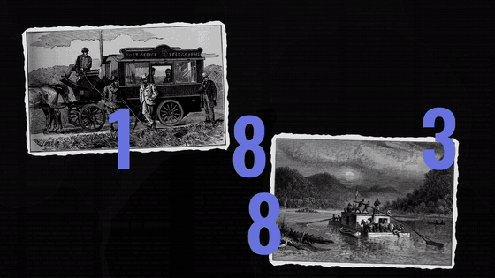</a><br><b>Why railroads gave America time zones</b><br>30 s · 7 scenes from 5 blocks · the first video to try<br><code>video-projects/example-time-zones</code> | <a href="starters/world-time.md">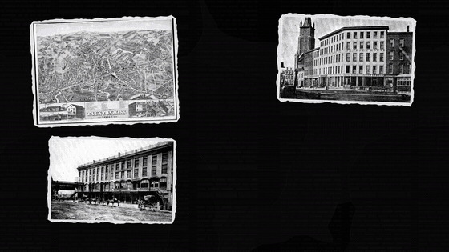</a><br><b>How the world agreed on time</b><br>39 s · 10 scenes from 10 blocks · every evidence block in one story<br><code>video-projects/example-world-time</code> |
<!-- /starters-gallery -->

## Write your own

Start from this shape. Replace the `{…}` parts, keep the blocks you want and delete the rest. The order of the lines
is the order of the video.

```text
Make a {LENGTH}-second Vox-style explainer: "{YOUR TOPIC OR QUESTION}".
Look: voxEarworm. Audience: {WHO IT IS FOR}. Pictures from the shared free-licence catalog, a {MOOD} music bed.
Build it from these blocks, in order:
1. Hook: [block: cold-open-year] {YEAR}, {PLACE}; {ONE TO THREE} archival pictures of {WHAT LIFE LOOKED LIKE}.
2. The question: [block: keyword-cut] {WORD} over a photo of {SUBJECT}.
3. Series ident: [block: series-ident] our series "{SERIES NAME}", card style, right after the question.
4. Context: [block: montage-crane] {NOUN → PICTURE}, {NOUN → PICTURE}, {NOUN → PICTURE}; label each.
5. Evidence: [block: document-highlight] {DOCUMENT}; highlight {PASSAGE} and ring {PARTS} as they are named.
6. The number: [block: data-counter] count up to {NUMBER} with the label "{LABEL}".
7. The turn: [block: footage-clip] footage of {SUBJECT}, with a "{DATE}" tag.
8. Ending: [block: end-card] our series "{SERIES NAME}", tagline "{TAGLINE}".
```

What Claude does with it:
1. It researches your topic first. Blocks shape the pictures; the facts in the script come only from sources it
   records in `RESEARCH.md`, never from these examples. A block line that asks for a number or a quote is checked
   like any other claim.
2. It directs the video with you. At each step it recommends an answer and asks: the angle, a block per section (with
   each block's sketch as a preview), the script, the voice, what to use where something is missing, the music. Say
   "autopilot" and it decides the rest on its own.
3. It builds one scene per block and renders a draft with a scratch voice. You record your own voice later; the video
   re-times to it.

Fill in only what you care about. A bare `[block: map-route]` is enough: Claude picks the region, the route and the
labels from the script.

## Blocks

Click a block for its prompt template, the prompt behind the preview, the scene it produced and the notes Claude
follows when it sees the tag.

<!-- blocks-gallery -->
| | |
|---|---|
| <a href="blocks/cold-open-year.md">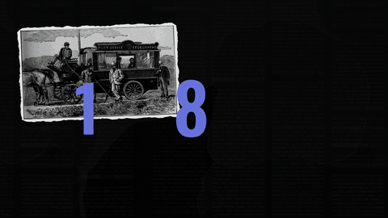</a><br><b>Cold open on a year</b><br>Hook · <code>ColdOpenYear</code><br><code>[block: cold-open-year]</code> | <a href="blocks/data-bars.md">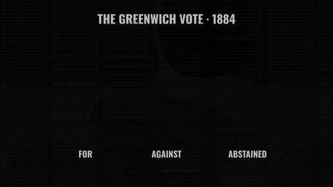</a><br><b>Bar chart</b><br>Evidence: a comparison · <code>DataChart</code><br><code>[block: data-bars]</code> |
| <a href="blocks/data-counter.md">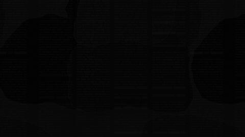</a><br><b>Number counter</b><br>Evidence: one number · <code>DataChart</code><br><code>[block: data-counter]</code> | <a href="blocks/document-highlight.md">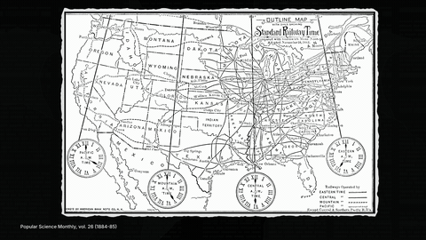</a><br><b>Document highlight</b><br>Evidence: a document · <code>DocumentHighlight</code><br><code>[block: document-highlight]</code> |
| <a href="blocks/end-card.md">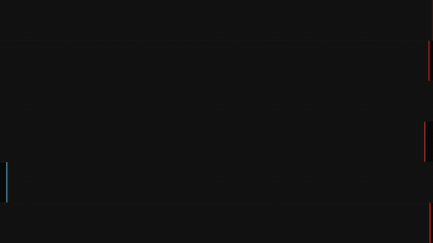</a><br><b>End card</b><br>Ending · <code>EndCard</code><br><code>[block: end-card]</code> | <a href="blocks/footage-clip.md">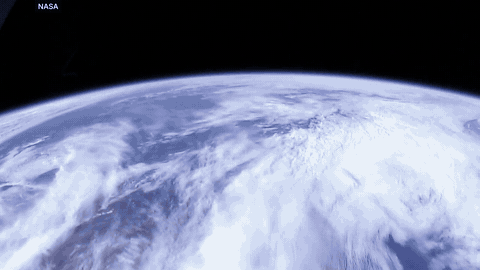</a><br><b>Archival footage</b><br>The turn / today / B-roll · <code>FootageClip</code><br><code>[block: footage-clip]</code> |
| <a href="blocks/giant-word-card.md">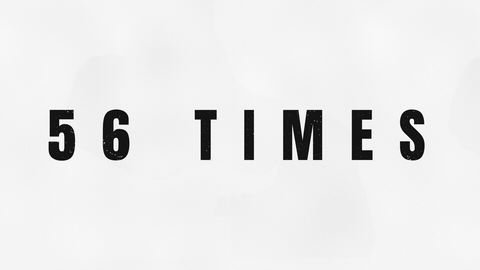</a><br><b>Giant word or number</b><br>The number / the claim · <code>GiantWordCard</code><br><code>[block: giant-word-card]</code> | <a href="blocks/keyword-cut.md">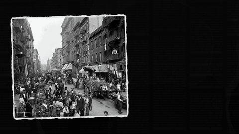</a><br><b>Keyword over a photo</b><br>Context · <code>KeywordCut</code><br><code>[block: keyword-cut]</code> |
| <a href="blocks/map-route.md">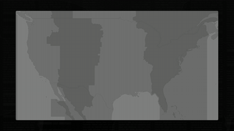</a><br><b>Map with a route</b><br>Where it happened · <code>MapRoute</code><br><code>[block: map-route]</code> | <a href="blocks/montage-crane.md">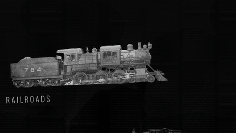</a><br><b>Montage crane</b><br>Context: a list of things · <code>MontageCrane</code><br><code>[block: montage-crane]</code> |
| <a href="blocks/name-card.md">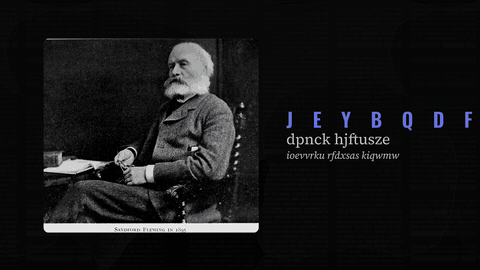</a><br><b>Name card</b><br>A person, first appearance · <code>NameCardInterview</code><br><code>[block: name-card]</code> | <a href="blocks/photo-collage.md">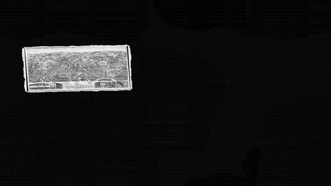</a><br><b>Photo collage</b><br>Hook / setting the scene · <code>PhotoCollageUnfold</code><br><code>[block: photo-collage]</code> |
| <a href="blocks/quote-card.md">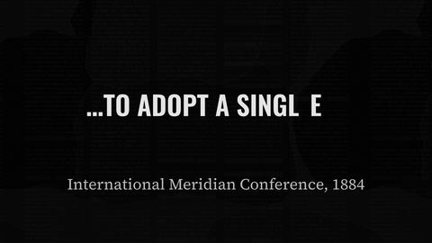</a><br><b>Quote card</b><br>Evidence: a quotation · <code>QuoteCard</code><br><code>[block: quote-card]</code> | <a href="blocks/series-ident.md"></a><br><b>Series ident</b><br>After the question (10–17 % of the runtime) · <code>SeriesIdent</code><br><code>[block: series-ident]</code> |
<!-- /blocks-gallery -->

### A typical order (60–90 s)

| Section | Blocks that fit |
|---|---|
| Hook (first 3–6 s) | [cold-open-year](blocks/cold-open-year.md), [photo-collage](blocks/photo-collage.md) |
| The question or thesis | [keyword-cut](blocks/keyword-cut.md), [giant-word-card](blocks/giant-word-card.md) |
| Series ident | [series-ident](blocks/series-ident.md) |
| Context | [montage-crane](blocks/montage-crane.md), [map-route](blocks/map-route.md), [keyword-cut](blocks/keyword-cut.md) |
| Evidence | [document-highlight](blocks/document-highlight.md), [quote-card](blocks/quote-card.md), [name-card](blocks/name-card.md), [data-counter](blocks/data-counter.md), [data-bars](blocks/data-bars.md) |
| The turn | [footage-clip](blocks/footage-clip.md), [giant-word-card](blocks/giant-word-card.md) |
| Ending | [end-card](blocks/end-card.md) |

### Not in the gallery yet

You can still ask for these by recipe name (doc 14 §3 lists their props):
- `KaraokeQuote`: an archival recording with its words popping on screen. It needs a public-domain recording, which
  the examples don't have yet.
- The 9:16 Short recipes: `ShortHook`, `ShortPhoto`, `ShortDocument`, `ShortTimeline`, `ShortSteps`, `ShortQuote`,
  `ShortEnd`. Ask for "a YouTube Short".

## About the previews

- **Format:** blocks 480 px, starter reels 560 px, 12 frames per second (the kit's drawing rate).
- **Finish:** rendered without the film grain, weave, dust and flicker that change on every frame, so each GIF stays
  small. The real render has them.
- **Pictures:** public domain or CC0, from the shared catalog. The credits are in each example project's `CREDITS.md`.
- **Regenerate them** after you change an example or the kit: `tools/py tools/examples/make_gallery.py`. It renders
  the example projects, cuts every GIF, and updates the scene JSON on each block page and the tables above.

## Add a block or a starter

1. Build the scene in an example project, with every fact sourced in its `RESEARCH.md`.
2. Copy a block page (`blocks/<name>.md`) and point its front matter at the scene (`example: <slug>#<scene id>`).
3. Run `make_gallery.py --only <name>`, look at the GIF, then run `tools/py tools/dev/release_audit.py` (it checks the
   size of the previews).
