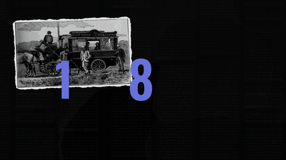

# Cold open on a year



A year flies in over torn archival prints, with the place under it: the first seconds of the video.

**Use it for:** the first 3–6 seconds. **Section:** Hook. **Recipe:** `ColdOpenYear` (props and events: [doc 14 §3](../../docs/style-guide/14-production-pipeline.md)).

## Wireframe

The layout at a glance (what Claude shows in a question's preview before anything is rendered):

```text
+--------------------------------------+
| .--------.                           |
| | print  |         1 8 8 3           |
| '--------'     [ UNITED STATES ]     |
|                          .--------.  |
|                          | print  |  |
|                          '--------'  |
+--------------------------------------+
```

## Prompt

Fill in the `{…}` parts and add the line to your video request (see [the starters](../starters/)), or send it on its
own inside a project you already have ("add this to the third section: …").

```text
[block: cold-open-year] Open on the year {YEAR} in {PLACE}. Collage {ONE TO THREE} archival pictures of {WHAT LIFE LOOKED LIKE THEN}.
```

## The prompt behind the preview

```text
[block: cold-open-year] Open on the year 1883 in the United States. Collage two archival pictures: a telegraph van and a river flatboat.
```

The narration it was built on (`video-projects/example-time-zones/script.md`):

> Before eighteen eighty-three, towns across America kept their own time.

## What the agent builds

Scene `open` of `video-projects/example-time-zones/storyboard.json`, as the agent wrote it (kept in step by
`tools/py tools/examples/make_gallery.py`):

<!-- scene-json -->
```json
{
 "id": "open",
 "recipe": "ColdOpenYear",
 "start": {
  "word": "Before"
 },
 "props": {
  "year": "1883",
  "place": "UNITED STATES",
  "pieces": [
   {
    "src": "kit:assets/library/engravings/machines/engr-telegraph-van-1874.jpg",
    "x": 110,
    "y": 110,
    "w": 760,
    "h": 470,
    "rotate": -2
   },
   {
    "src": "kit:assets/library/engravings/transport/engr-flatboat-river-waud.jpg",
    "x": 1060,
    "y": 540,
    "w": 700,
    "h": 485,
    "rotate": 1.5
   }
  ]
 },
 "events": [
  {
   "id": "year",
   "at": {
    "word": "eighteen",
    "kind": "text"
   }
  }
 ],
 "note": "slot=hook claim=fact (RESEARCH 1)"
}
```
<!-- /scene-json -->

## Agent notes

How Claude turns `[block: cold-open-year]` into a scene (the `vox-video` skill reads this section):

- **Script:** one sentence that names the time (and the place); spell the year as spoken. Anchor the scene on the sentence's first word.
- **Storyboard:** `year` (digits), `place` (caps), `pieces[]` with `x, y, w, h` in design px (1920×1080) that follow each picture's aspect; keep the centre band free for the year. Event `year` on the year's first spoken word (kind `text`).
- **Assets:** pictures from BEFORE the year named (`search.py "<subject> <decade>" --kind engravings|photos`).
- **Check:** a still after the year lands: no print covers the digits.
