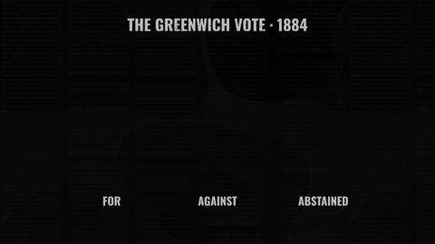

# Bar chart



Bars grow to their values on the spoken number, each labelled.

**Use it for:** two to five numbers side by side. **Section:** Evidence: a comparison. **Recipe:** `DataChart` (props and events: [doc 14 §3](../../docs/style-guide/14-production-pipeline.md)).

## Wireframe

The layout at a glance (what Claude shows in a question's preview before anything is rendered):

```text
+--------------------------------------+
|       THE GREENWICH VOTE . 1884      |
|        22                            |
|      ######                          |
|      ######      1         2         |
|      ######   ######    ######       |
|       FOR    AGAINST  ABSTAINED      |
+--------------------------------------+
```

## Prompt

Fill in the `{…}` parts and add the line to your video request (see [the starters](../starters/)), or send it on its
own inside a project you already have ("add this to the third section: …").

```text
[block: data-bars] Bars for {A: N, B: M, …} titled "{LABEL}".
```

## The prompt behind the preview

```text
[block: data-bars] Bars for the vote: for 22, against 1, abstained 2, titled "THE GREENWICH VOTE · 1884".
```

The narration it was built on (`video-projects/example-world-time/script.md`):

> Greenwich won the vote: twenty-two to one, with two abstaining.

## What the agent builds

Scene `vote` of `video-projects/example-world-time/storyboard.json`, as the agent wrote it (kept in step by
`tools/py tools/examples/make_gallery.py`):

<!-- scene-json -->
```json
{
 "id": "vote",
 "recipe": "DataChart",
 "start": {
  "word": "Greenwich"
 },
 "props": {
  "mode": "bars",
  "label": "THE GREENWICH VOTE · 1884",
  "bars": [
   {
    "label": "FOR",
    "value": 22,
    "display": "22"
   },
   {
    "label": "AGAINST",
    "value": 1,
    "display": "1"
   },
   {
    "label": "ABSTAINED",
    "value": 2,
    "display": "2"
   }
  ]
 },
 "events": [
  {
   "id": "count",
   "at": {
    "word": "twenty-two",
    "kind": "object"
   }
  }
 ],
 "note": "block data-bars; slot=payoff claim=number (RESEARCH 7)"
}
```
<!-- /scene-json -->

## Agent notes

How Claude turns `[block: data-bars]` into a scene (the `vox-video` skill reads this section):

- **Storyboard:** `mode: "bars"`, `label`, `bars[{label, value, display}]` (2–5). Event `count` on the first spoken number (kind `object`).
- **Facts:** every value comes from `RESEARCH.md`.
