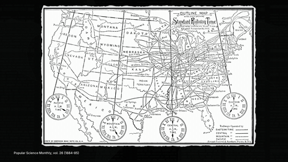

# Document highlight



A scanned page on the collage; a highlighter sweeps a passage and hand rings land on the parts as they are named.

**Use it for:** proof from a primary source: a page, a map, a patent, a newspaper. **Section:** Evidence: a document. **Recipe:** `DocumentHighlight` (props and events: [doc 14 §3](../../docs/style-guide/14-production-pipeline.md)).

## Wireframe

The layout at a glance (what Claude shows in a question's preview before anything is rendered):

```text
+--------------------------------------+
|  .--------------------------------.  |
|  | ~~~~ [== highlighted title ==] |  |
|  | ~~~~~~~~ scanned page ~~~~~~~~ |  |
|  |  (o)      (o)      (o)    (o)  |  |
|  |  rings land as each is named   |  |
|  '--------------------------------'  |
|  source line                         |
+--------------------------------------+
```

## Prompt

Fill in the `{…}` parts and add the line to your video request (see [the starters](../starters/)), or send it on its
own inside a project you already have ("add this to the third section: …").

```text
[block: document-highlight] Show {DOCUMENT}; highlight {PASSAGE} on "{WORD}" and ring {PARTS} as they are named.
```

## The prompt behind the preview

```text
[block: document-highlight] Show the 1883 standard railway time map; highlight its title on "adopted" and ring the four zone clocks as they are named.
```

The narration it was built on (`video-projects/example-world-time/script.md`):

> In eighteen eighty-three, American railroads adopted four zones: Pacific, Mountain, Central and Eastern.

## What the agent builds

Scene `map1883` of `video-projects/example-world-time/storyboard.json`, as the agent wrote it (kept in step by
`tools/py tools/examples/make_gallery.py`):

<!-- scene-json -->
```json
{
 "id": "map1883",
 "recipe": "DocumentHighlight",
 "start": {
  "word": "In"
 },
 "props": {
  "src": "kit:assets/library/maps/historical/map-standard-railway-time-1884.jpg",
  "box": {
   "x": 300,
   "y": 60,
   "w": 1380,
   "h": 895
  },
  "highlights": [
   {
    "x": 1147,
    "y": 124,
    "w": 291,
    "h": 48,
    "at": {
     "word": "adopted",
     "kind": "highlight"
    }
   }
  ],
  "rings": [
   {
    "cx": 398,
    "cy": 710,
    "rx": 100,
    "ry": 96,
    "at": {
     "word": "Pacific"
    }
   },
   {
    "cx": 758,
    "cy": 846,
    "rx": 100,
    "ry": 96,
    "at": {
     "word": "Mountain"
    }
   },
   {
    "cx": 1151,
    "cy": 858,
    "rx": 100,
    "ry": 96,
    "at": {
     "word": "Central"
    }
   },
   {
    "cx": 1551,
    "cy": 704,
    "rx": 100,
    "ry": 96,
    "at": {
     "word": "Eastern"
    }
   }
  ],
  "source": "Popular Science Monthly, vol. 26 (1884-85)"
 },
 "note": "block document-highlight; slot=evidence claim=document (RESEARCH 5)"
}
```
<!-- /scene-json -->

## Agent notes

How Claude turns `[block: document-highlight]` into a scene (the `vox-video` skill reads this section):

- **Coordinates:** `box` places the page (design px, the scan's aspect). Highlights and rings are in design px: `box.x + page_x × box.w / image_width` (same for y). Look at the scan first and measure the passages.
- **Storyboard:** `src`, `box`, `highlights[{x, y, w, h, at}]` (kind `highlight`), `rings[{cx, cy, rx, ry, at}]` (the word that names each part), `source` (the publication, bottom-left: keep it clear of the page). Text pages also take `readAlong`, `isolate` and `push` (doc 14 §3).
- **Assets:** `search.py <subject> --kind documents|maps`.
