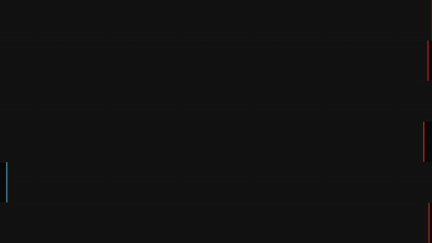

# End card



Our series name glitches in with a tagline; the video ends on it.

**Use it for:** the last 3–4 seconds. **Section:** Ending. **Recipe:** `EndCard` (props and events: [doc 14 §3](../../docs/style-guide/14-production-pipeline.md)).

## Wireframe

The layout at a glance (what Claude shows in a question's preview before anything is rendered):

```text
+--------------------------------------+
|                                      |
|                                      |
|            T I M E   D E S K         |
|             A KIT EXAMPLE            |
|                 ----                 |
|                                      |
+--------------------------------------+
```

## Prompt

Fill in the `{…}` parts and add the line to your video request (see [the starters](../starters/)), or send it on its
own inside a project you already have ("add this to the third section: …").

```text
[block: end-card] End on our series name "{SERIES}" with the tagline "{TAGLINE}".
```

## The prompt behind the preview

```text
[block: end-card] End on our series name "TIME DESK" with the tagline "A KIT EXAMPLE".
```

The narration it was built on (`video-projects/example-time-zones/script.md`):

> (none: the card follows the last line, "Congress only made the zones law in nineteen eighteen.")

## What the agent builds

Scene `end` of `video-projects/example-time-zones/storyboard.json`, as the agent wrote it (kept in step by
`tools/py tools/examples/make_gallery.py`):

<!-- scene-json -->
```json
{
 "id": "end",
 "recipe": "EndCard",
 "start": {
  "word": "eighteen",
  "nth": 3,
  "edge": "end",
  "offset": 20
 },
 "transitionIn": {
  "kind": "glitchCut"
 },
 "props": {
  "title": "TIME DESK",
  "tagline": "A KIT EXAMPLE"
 }
}
```
<!-- /scene-json -->

## Agent notes

How Claude turns `[block: end-card]` into a scene (the `vox-video` skill reads this section):

- **Storyboard:** `title`, `tagline`; `transitionIn: {"kind": "glitchCut"}`; the storyboard's `end: {"scene": "end", "tailSec": 3–3.5}`. Start it about 20 f after the last word (`edge: "end"`).
- **Never** a real channel's mark or wordmark: always the user's own series name (`NOTICE.md`).
- Credits pages instead: `mode: "credits"` (drawn for the `voxLight` look).
