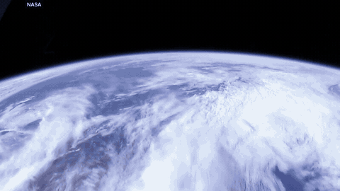

# Archival footage



A public-domain film clip, full frame in its own colour, with a corner source tag and a date tag.

**Use it for:** moving pictures: a turn to the present, a place, an event on film. **Section:** The turn / today / B-roll. **Recipe:** `FootageClip` (props and events: [doc 14 §3](../../docs/style-guide/14-production-pipeline.md)).

## Wireframe

The layout at a glance (what Claude shows in a question's preview before anything is rendered):

```text
+--------------------------------------+
| [NASA]                               |
|  TODAY                               |
|      ~~~ moving footage, full ~~~    |
|      ~~~ frame, its own colour ~~~   |
|                                      |
|                                      |
+--------------------------------------+
```

## Prompt

Fill in the `{…}` parts and add the line to your video request (see [the starters](../starters/)), or send it on its
own inside a project you already have ("add this to the third section: …").

```text
[block: footage-clip] Cut to footage of {SUBJECT} ({SOURCE}){, silent | with its own sound}, with a "{DATE}" tag.
```

## The prompt behind the preview

```text
[block: footage-clip] Cut to NASA footage of Earth from the space station, silent, with a "TODAY" date tag.
```

The narration it was built on (`video-projects/example-world-time/script.md`):

> The conference itself never created time zones. Today, the world's zones are set as offsets from Coordinated Universal Time.

## What the agent builds

Scene `today` of `video-projects/example-world-time/storyboard.json`, as the agent wrote it (kept in step by
`tools/py tools/examples/make_gallery.py`):

<!-- scene-json -->
```json
{
 "id": "today",
 "recipe": "FootageClip",
 "start": {
  "word": "conference",
  "offset": -6
 },
 "props": {
  "src": "kit:assets/library/footage/space/film-earth-from-iss-clouds.mp4",
  "startFromSec": 1,
  "audio": false,
  "tag": "NASA",
  "dateTag": {
   "text": "TODAY"
  }
 },
 "events": [
  {
   "id": "date",
   "at": {
    "word": "Today",
    "kind": "text"
   }
  }
 ],
 "note": "block footage-clip; slot=turn claim=fact (RESEARCH 8, 9)"
}
```
<!-- /scene-json -->

## Agent notes

How Claude turns `[block: footage-clip]` into a scene (the `vox-video` skill reads this section):

- **Assets:** `search.py <subject> --kind footage` (NASA, Prelinger PDM, NARA); every clip needs a `CREDITS.md` line.
- **Storyboard:** `src`, `startFromSec`, `audio: false` for B-roll (with sound: `audioDb`, `audioLeadF` for a J-cut, `bed: duck|out`), `tag` (the source, top-left), `dateTag{text}` with event `date` on its word (kind `text`).
