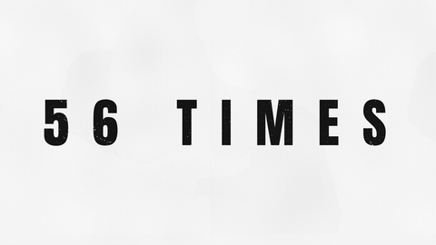

# Giant word or number



A word or number fills the frame, with an optional small torn photo tucked beside it.

**Use it for:** the line that carries the key number or claim. **Section:** The number / the claim. **Recipe:** `GiantWordCard` (props and events: [doc 14 §3](../../docs/style-guide/14-production-pipeline.md)).

## Wireframe

The layout at a glance (what Claude shows in a question's preview before anything is rendered):

```text
+--------------------------------------+
|                                      |
|      ##   ####   T I M E S           |
|      56          (fills the frame)   |
|                          .-------.   |
|                          | photo |   |
|                          '-------'   |
+--------------------------------------+
```

## Prompt

Fill in the `{…}` parts and add the line to your video request (see [the starters](../starters/)), or send it on its
own inside a project you already have ("add this to the third section: …").

```text
[block: giant-word-card] Fill the screen with "{TEXT}"{, with a small photo of SUBJECT}.
```

## The prompt behind the preview

```text
[block: giant-word-card] Fill the screen with "56 TIMES", with a small locomotive photo.
```

The narration it was built on (`video-projects/example-time-zones/script.md`):

> For the railroads, that was a problem: by one count, they ran on fifty-six different times.

## What the agent builds

Scene `railroads` of `video-projects/example-time-zones/storyboard.json`, as the agent wrote it (kept in step by
`tools/py tools/examples/make_gallery.py`):

<!-- scene-json -->
```json
{
 "id": "railroads",
 "recipe": "GiantWordCard",
 "start": {
  "word": "For"
 },
 "props": {
  "text": "56 TIMES",
  "ground": "white",
  "photo": "kit:assets/library/photos/transport/photo-steam-locomotive-side-1901.jpg",
  "photoBox": {
   "x": 1180,
   "y": 660,
   "w": 560,
   "h": 182,
   "rotate": 2
  }
 },
 "events": [
  {
   "id": "photo",
   "at": {
    "word": "railroads",
    "kind": "object"
   }
  }
 ],
 "note": "slot=question claim=number (RESEARCH 2)"
}
```
<!-- /scene-json -->

## Agent notes

How Claude turns `[block: giant-word-card]` into a scene (the `vox-video` skill reads this section):

- **Script:** spell the number as spoken; the number itself must be in `RESEARCH.md` (keep qualifiers such as "by one count").
- **Storyboard:** `text` (1–2 words or a number), `ground: white|black`, optional `photo` + `photoBox` (design px) that never covers the letters. Event `photo` on the noun it shows (kind `object`).
- **Check:** a still with the photo in: every letter readable.
