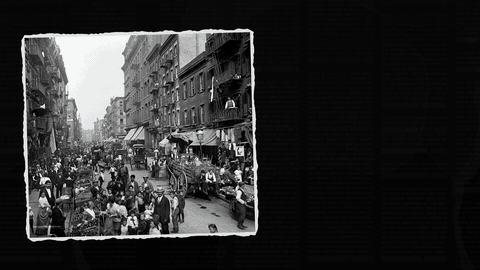

# Keyword over a photo



One word slams onto a torn photo exactly on the spoken word, with a small line under it.

**Use it for:** any line that turns on one word. **Section:** Context. **Recipe:** `KeywordCut` (props and events: [doc 14 §3](../../docs/style-guide/14-production-pipeline.md)).

## Wireframe

The layout at a glance (what Claude shows in a question's preview before anything is rendered):

```text
+--------------------------------------+
| .---------------.                    |
| |               |      NOON          |
| |  torn photo   |   (slams on the    |
| |               |    spoken word)    |
| '---------------'   NEW YORK . PHILA |
|                                      |
+--------------------------------------+
```

## Prompt

Fill in the `{…}` parts and add the line to your video request (see [the starters](../starters/)), or send it on its
own inside a project you already have ("add this to the third section: …").

```text
[block: keyword-cut] The word {WORD} pops over a photo of {SUBJECT}, with "{SMALL LINE}" under it.
```

## The prompt behind the preview

```text
[block: keyword-cut] The word NOON pops over a busy street photo from about 1900, with "NEW YORK · PHILADELPHIA" under it.
```

The narration it was built on (`video-projects/example-time-zones/script.md`):

> Noon came when the sun stood highest, so noon in New York was not noon in Philadelphia.

## What the agent builds

Scene `noon` of `video-projects/example-time-zones/storyboard.json`, as the agent wrote it (kept in step by
`tools/py tools/examples/make_gallery.py`):

<!-- scene-json -->
```json
{
 "id": "noon",
 "recipe": "KeywordCut",
 "start": {
  "word": "Noon"
 },
 "props": {
  "src": "kit:assets/library/photos/cities/photo-mulberry-street-nyc-1900.jpg",
  "word": "NOON",
  "sub": "NEW YORK · PHILADELPHIA",
  "side": "left"
 },
 "events": [
  {
   "id": "pop",
   "at": {
    "word": "Noon",
    "kind": "pop"
   }
  },
  {
   "id": "sub",
   "at": {
    "word": "Philadelphia",
    "kind": "object"
   }
  }
 ],
 "note": "slot=context claim=fact (RESEARCH 1)"
}
```
<!-- /scene-json -->

## Agent notes

How Claude turns `[block: keyword-cut]` into a scene (the `vox-video` skill reads this section):

- **Script:** stress the keyword (`*Noon*`); start the scene on the sentence's first word.
- **Storyboard:** `src`, `word` (caps, ≤ 10 letters reads best), `sub`, `side: left|right` (the side away from the photo's subject). Events `pop` on the keyword (kind `pop`) and `sub` on the word the small line names (kind `object`).
- **Assets:** a photo with an empty side for the word (`--kind photos`).
