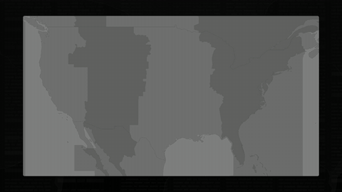

# Map with a route



A route draws across a base map through its waypoints, then a label names what changed.

**Use it for:** geography: a spread, a journey, borders, zones. **Section:** Where it happened. **Recipe:** `MapRoute` (props and events: [doc 14 §3](../../docs/style-guide/14-production-pipeline.md)).

## Wireframe

The layout at a glance (what Claude shows in a question's preview before anything is rendered):

```text
+--------------------------------------+
|  .--------------------------------.  |
|  |   x SF     .-- o CHI ---o NY   |  |
|  |    \______/   o DEN            |  |
|  |  [ 4 ZONES ]                   |  |
|  |  [ NOV 18 . 1883 ]  base map   |  |
|  '--------------------------------'  |
+--------------------------------------+
```

## Prompt

Fill in the `{…}` parts and add the line to your video request (see [the starters](../starters/)), or send it on its
own inside a project you already have ("add this to the third section: …").

```text
[block: map-route] A map of {REGION}{ with its time zones}; draw a route {A → B → C}; label "{TITLE}", "{SUBTITLE}".
```

## The prompt behind the preview

```text
[block: map-route] A map of the US time zones; draw a route New York → Chicago → Denver → San Francisco; label "4 ZONES", "NOV 18 · 1883".
```

The narration it was built on (`video-projects/example-time-zones/script.md`):

> So on November eighteenth, eighteen eighty-three, they split the country into four time zones.

## What the agent builds

Scene `zones` of `video-projects/example-time-zones/storyboard.json`, as the agent wrote it (kept in step by
`tools/py tools/examples/make_gallery.py`):

<!-- scene-json -->
```json
{
 "id": "zones",
 "recipe": "MapRoute",
 "start": {
  "word": "So",
  "nth": 2
 },
 "props": {
  "map": "assets/maps/region-usa-time-zones-paper.png",
  "mapBox": {
   "x": 0,
   "y": -36,
   "w": 1660
  },
  "waypoints": [
   {
    "x": 1531,
    "y": 421
   },
   {
    "x": 1178,
    "y": 382
   },
   {
    "x": 727,
    "y": 452
   },
   {
    "x": 275,
    "y": 516
   }
  ],
  "label": {
   "title": "4 ZONES",
   "sub": "NOV 18 · 1883"
  }
 },
 "events": [
  {
   "id": "route",
   "at": {
    "word": "split",
    "kind": "object"
   },
   "until": {
    "word": "zones",
    "edge": "end"
   }
  },
  {
   "id": "label",
   "at": {
    "word": "four",
    "kind": "title"
   }
  }
 ],
 "note": "slot=turn claim=place (RESEARCH 3); map: tools/library/make_maps.py region usa --time-zones; waypoints: make_maps.py locate"
}
```
<!-- /scene-json -->

## Agent notes

How Claude turns `[block: map-route]` into a scene (the `vox-video` skill reads this section):

- **Base map:** `tools/py tools/library/make_maps.py region <name> --box lon0,lat0,lon1,lat1 [--time-zones] --project <slug>` or `make_maps.py country <ISO3> --project <slug>` (Natural Earth, public domain); add it to the project's `build.json` so `build_example.py` can rebuild it.
- **Waypoints:** `make_maps.py locate <map.png> --at lon,lat … --mapbox x,y,w` prints them in design px.
- **Storyboard:** `map`, `mapBox`, `waypoints[]`, `label{title, sub}`. Events `route` (kind `object`, `until` the end of the phrase) and `label` (kind `title`).
