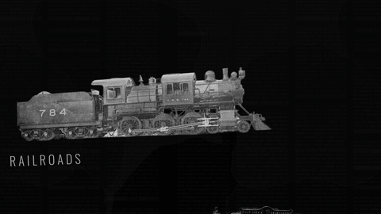

# Montage crane



One camera tilt down through a stack of prints and cut-outs, each crossed as its noun is spoken.

**Use it for:** a sentence that lists two to four things. **Section:** Context: a list of things. **Recipe:** `MontageCrane` (props and events: [doc 14 §3](../../docs/style-guide/14-production-pipeline.md)).

## Wireframe

The layout at a glance (what Claude shows in a question's preview before anything is rendered):

```text
+--------------------------------------+
|   .----------.      camera tilts     |
|   | cut-out  |  RAILROADS     |      |
|   '----------'                |      |
|          .--------.          v       |
|          |cut-out |  TELEGRAPH       |
|          '--------'   ...            |
+--------------------------------------+
```

## Prompt

Fill in the `{…}` parts and add the line to your video request (see [the starters](../starters/)), or send it on its
own inside a project you already have ("add this to the third section: …").

```text
[block: montage-crane] The camera tilts down through {TWO TO FOUR} pictures, one per noun: {NOUN → PICTURE}, …; label each.
```

## The prompt behind the preview

```text
[block: montage-crane] The camera tilts down through three pictures, one per noun: railroads → a locomotive cut-out, telegraph → a telegraph van cut-out, continent → a railroad map; label each.
```

The narration it was built on (`video-projects/example-world-time/script.md`):

> By the eighteen seventies, railroads and telegraph lines crossed the whole continent.

## What the agent builds

Scene `montage` of `video-projects/example-world-time/storyboard.json`, as the agent wrote it (kept in step by
`tools/py tools/examples/make_gallery.py`):

<!-- scene-json -->
```json
{
 "id": "montage",
 "recipe": "MontageCrane",
 "start": {
  "word": "By",
  "nth": 2
 },
 "transitionIn": {
  "kind": "cut",
  "hole": 6
 },
 "props": {
  "items": [
   {
    "src": "kit:assets/library/cutouts/transport/cut-steam-locomotive-1901.png",
    "cutout": true,
    "w": 900,
    "h": 243,
    "label": "RAILROADS",
    "at": {
     "word": "seventies"
    }
   },
   {
    "src": "kit:assets/library/cutouts/transport/cut-telegraph-van-1874.png",
    "cutout": true,
    "w": 640,
    "h": 395,
    "label": "TELEGRAPH",
    "at": {
     "word": "telegraph"
    }
   },
   {
    "src": "kit:assets/library/maps/historical/map-rand-mcnally-railroads-us.jpg",
    "w": 640,
    "h": 382,
    "label": "COAST TO COAST",
    "at": {
     "word": "continent"
    }
   }
  ]
 },
 "note": "block montage-crane; slot=context claim=fact (RESEARCH 2)"
}
```
<!-- /scene-json -->

## Agent notes

How Claude turns `[block: montage-crane]` into a scene (the `vox-video` skill reads this section):

- **Storyboard:** `items[]` in spoken order, each with `at` (a word anchor on its noun), `src`, `cutout: true` for PNG cut-outs, `w, h` (follow the aspect), `label` (caps, ≤ 16 letters). Keys closer than ~0.5 s rush the camera: key the first item on an earlier word.
- **Assets:** cut-outs read best (`search.py <noun> --kind cutouts`; make one with `tools/library/add.py cutout <id>`).
- **Check:** stills at each key: near layers are pushed outward, so every print and label must stay in the frame.
