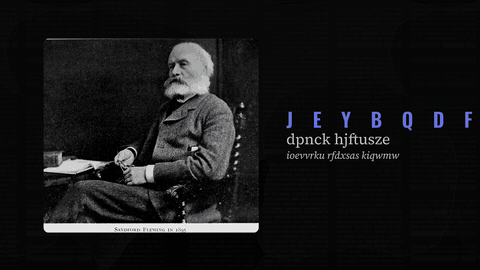

# Name card



A portrait (or interview clip) in a window, with a decoding name card: name, role, organisation.

**Use it for:** the first time a person appears. **Section:** A person, first appearance. **Recipe:** `NameCardInterview` (props and events: [doc 14 §3](../../docs/style-guide/14-production-pipeline.md)).

## Wireframe

The layout at a glance (what Claude shows in a question's preview before anything is rendered):

```text
+--------------------------------------+
|   .-------------.                    |
|   |             |   SANDFORD FLEMING |
|   |  portrait   |   Chief engineer   |
|   |   window    |   Canadian Pacific |
|   '-------------'   Survey           |
|                                      |
+--------------------------------------+
```

## Prompt

Fill in the `{…}` parts and add the line to your video request (see [the starters](../starters/)), or send it on its
own inside a project you already have ("add this to the third section: …").

```text
[block: name-card] Introduce {NAME}, {ROLE} of {ORGANISATION}, with {their portrait | their interview clip}.
```

## The prompt behind the preview

```text
[block: name-card] Introduce Sandford Fleming, chief engineer of the Canadian Pacific Survey, with his 1895 portrait.
```

The narration it was built on (`video-projects/example-world-time/script.md`):

> Railway engineer Sandford Fleming pushed for one system for the whole world.

## What the agent builds

Scene `fleming` of `video-projects/example-world-time/storyboard.json`, as the agent wrote it (kept in step by
`tools/py tools/examples/make_gallery.py`):

<!-- scene-json -->
```json
{
 "id": "fleming",
 "recipe": "NameCardInterview",
 "start": {
  "word": "Railway"
 },
 "props": {
  "src": "kit:assets/library/portraits/named/portrait-sandford-fleming-1895.jpg",
  "name": "Sandford Fleming",
  "title": "Chief engineer",
  "affiliation": "Canadian Pacific Survey"
 },
 "events": [
  {
   "id": "resolve",
   "at": {
    "word": "Sandford",
    "kind": "name"
   }
  }
 ],
 "note": "block name-card; slot=expert claim=person (RESEARCH 3)"
}
```
<!-- /scene-json -->

## Agent notes

How Claude turns `[block: name-card]` into a scene (the `vox-video` skill reads this section):

- **Facts:** the name and the role come from `RESEARCH.md`; the portrait must show that person (a public-domain photo of them, never a look-alike or a generic portrait with a name on it).
- **Storyboard:** `src` (a portrait still or an interview MP4), `name`, `title`, `affiliation`; `card: "lowerThird"` and `layout: "fullframe"` for interviews on the light look. Event `resolve` on the name's first word (kind `name`).
- **Assets:** `search.py "<name>" --kind portraits`; else `tools/library/stage.py <theme> "<name>" --kind portrait`, check the sheet, then `add.py image`.
