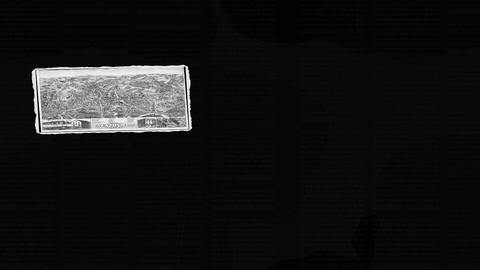

# Photo collage



Torn prints unfold one by one from alternating hinges; a keyword pops over them.

**Use it for:** the opening, or any 'this is what it was like' moment. **Section:** Hook / setting the scene. **Recipe:** `PhotoCollageUnfold` (props and events: [doc 14 §3](../../docs/style-guide/14-production-pipeline.md)).

## Wireframe

The layout at a glance (what Claude shows in a question's preview before anything is rendered):

```text
+--------------------------------------+
| .-------.                 .-------.  |
| | print |                 | print |  |
| '-------'    SUN TIME     '-------'  |
|   .-------.             .-------.    |
|   | print |             | print |    |
|   '-------'             '-------'    |
+--------------------------------------+
```

## Prompt

Fill in the `{…}` parts and add the line to your video request (see [the starters](../starters/)), or send it on its
own inside a project you already have ("add this to the third section: …").

```text
[block: photo-collage] Collage {THREE TO SIX} archival pictures of {SUBJECT}; the words "{TITLE}" pop on "{SPOKEN WORD}".
```

## The prompt behind the preview

```text
[block: photo-collage] Collage three pictures of American towns from the 1870s and a sundial engraving; the words "SUN TIME" pop on "sun".
```

The narration it was built on (`video-projects/example-world-time/script.md`):

> Towns used to set their clocks by the sun. So how did the whole world end up on one clock?

## What the agent builds

Scene `collage` of `video-projects/example-world-time/storyboard.json`, as the agent wrote it (kept in step by
`tools/py tools/examples/make_gallery.py`):

<!-- scene-json -->
```json
{
 "id": "collage",
 "recipe": "PhotoCollageUnfold",
 "start": {
  "word": "Towns"
 },
 "props": {
  "items": [
   {
    "src": "kit:assets/library/maps/cities/map-taunton-birds-eye-1875.jpg",
    "x": 150,
    "y": 90,
    "w": 600,
    "h": 434,
    "rotate": -2
   },
   {
    "src": "kit:assets/library/photos/cities/photo-buffalo-main-genesee-1870s.jpg",
    "x": 1200,
    "y": 80,
    "w": 560,
    "h": 352,
    "rotate": 2
   },
   {
    "src": "kit:assets/library/photos/cities/photo-buffalo-hazard-block-1870s.jpg",
    "x": 220,
    "y": 600,
    "w": 520,
    "h": 345,
    "rotate": 1
   },
   {
    "src": "kit:assets/library/engravings/science/engr-travelers-sundial-1891.jpg",
    "x": 1300,
    "y": 520,
    "w": 400,
    "h": 408,
    "rotate": -1.5,
    "at": {
     "word": "sun"
    }
   }
  ],
  "title": "SUN TIME"
 },
 "events": [
  {
   "id": "title",
   "at": {
    "word": "sun",
    "kind": "text"
   }
  }
 ],
 "note": "block photo-collage; slot=hook claim=fact (RESEARCH 1)"
}
```
<!-- /scene-json -->

## Agent notes

How Claude turns `[block: photo-collage]` into a scene (the `vox-video` skill reads this section):

- **Storyboard:** `items[]` (`src`, `x, y, w, h` following each picture's aspect, `rotate`; six default slots when left out), `title`. An item's `at` (a word anchor) unfolds it on its noun; the rest unfold every 5 f. Event `title` on the spoken word (kind `text`).
- Keep the centre free for the title; use pictures from the period the line talks about.
- **Assets:** `search.py "<place> <decade>" --kind photos`, `--kind engravings`, `--kind maps` (bird's-eye views work as prints).
