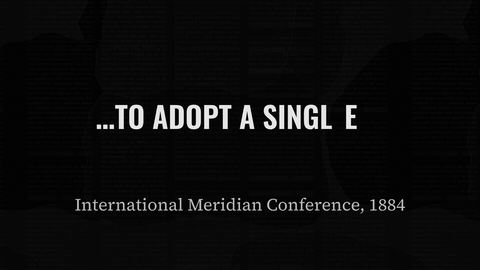

# Quote card



A quotation types itself out in caps, word for word, with its credit under it.

**Use it for:** the exact words of a source. **Section:** Evidence: a quotation. **Recipe:** `QuoteCard` (props and events: [doc 14 §3](../../docs/style-guide/14-production-pipeline.md)).

## Wireframe

The layout at a glance (what Claude shows in a question's preview before anything is rendered):

```text
+--------------------------------------+
|                                      |
|    ...TO ADOPT A SINGLE PRIME        |
|    MERIDIAN FOR ALL NATIONS...       |
|     (types itself, word for word)    |
|                                      |
|   International Meridian Conf., 1884 |
+--------------------------------------+
```

## Prompt

Fill in the `{…}` parts and add the line to your video request (see [the starters](../starters/)), or send it on its
own inside a project you already have ("add this to the third section: …").

```text
[block: quote-card] Type the words "{EXACT QUOTE}" with the credit "{WHO, WHERE, WHEN}".
```

## The prompt behind the preview

```text
[block: quote-card] Type the 1884 resolution's words "…to adopt a single prime meridian for all nations…" with the credit "International Meridian Conference, 1884".
```

The narration it was built on (`video-projects/example-world-time/script.md`):

> A year later, delegates in Washington resolved to adopt a single prime meridian for all nations.

## What the agent builds

Scene `resolution` of `video-projects/example-world-time/storyboard.json`, as the agent wrote it (kept in step by
`tools/py tools/examples/make_gallery.py`):

<!-- scene-json -->
```json
{
 "id": "resolution",
 "recipe": "QuoteCard",
 "start": {
  "word": "year",
  "offset": -4
 },
 "props": {
  "quote": "…to adopt a single prime meridian for all nations…",
  "attribution": "International Meridian Conference, 1884"
 },
 "events": [
  {
   "id": "type",
   "at": {
    "word": "year",
    "kind": "text"
   }
  },
  {
   "id": "done",
   "at": {
    "word": "nations",
    "edge": "end"
   }
  },
  {
   "id": "credit",
   "at": {
    "word": "delegates"
   }
  }
 ],
 "note": "block quote-card; slot=evidence claim=quote (RESEARCH 6)"
}
```
<!-- /scene-json -->

## Agent notes

How Claude turns `[block: quote-card]` into a scene (the `vox-video` skill reads this section):

- **Facts:** word for word from a source in `RESEARCH.md`; mark cuts with `…`; never paraphrase inside quotation marks.
- **Fit:** ≤ 4 lines of `wrap` (default 26) characters, and a credit ≤ ~40 characters (it is centred in one line).
- **Storyboard:** `quote`, `attribution`, `wrap`. Events `type` (start: the scene start, so the card is never empty), `done` (the end of the spoken quote, `edge: "end"`) and `credit`.
