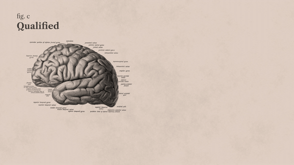

# Specimen comparison



Two specimens on one sheet, split by a dashed rule, each with its fig. letter, a title and callouts; a legend underneath.

**Use it for:** two groups, before and after, with and without. **Section:** A comparison. **Recipe:** `SpecimenCompare` (props and events: [doc 14 §3](../../docs/style-guide/14-production-pipeline.md)).

## Wireframe

The layout at a glance (what Claude shows in a question's preview before anything is rendered):

```text
+--------------------------------------+
| fig. c          :  fig. d            |
| Qualified       :  Did not qualify   |
|  .---------.    :   .---------.      |
|  | specimen|    :   | specimen|      |
|  '---------'    :   '---------'      |
| more grey matter:  no such change    |
+--------------------------------------+
```

## Prompt

Fill in the `{…}` parts and add the line to your video request (see [the starters](../starters/)), or send it on its
own inside a project you already have ("add this to the third section: …").

```text
[block: specimen-comparison] Two {SPECIMENS} side by side: fig. {a} "{LEFT}" ({LEFT CALLOUT}) and fig. {b} "{RIGHT}" ({RIGHT CALLOUT}){, with "LEGEND" below}.
```

## The prompt behind the preview

```text
[block: specimen-comparison] Two brain engravings side by side: fig. c "Qualified" (more grey matter in the posterior hippocampus) and fig. d "Did not qualify" (no such change, nor in 31 men who never trained), with the study as the legend.
```

The narration it was built on (`video-projects/example-cab-brain/script.md`):

> The ones who qualified grew more grey matter there. The ones who did not, and men who never trained, showed no such change.

## What the agent builds

Scene `compare` of `video-projects/example-cab-brain/storyboard.json`, as the agent wrote it (kept in step by
`tools/py tools/examples/make_gallery.py`):

<!-- scene-json -->
```json
{
 "id": "compare",
 "recipe": "SpecimenCompare",
 "start": {
  "word": "The",
  "nth": 8
 },
 "transitionIn": {
  "kind": "paperSlide",
  "variant": "out",
  "corner": "tr",
  "sfx": false
 },
 "props": {
  "left": {
   "fig": "fig. c",
   "title": "Qualified",
   "src": "kit:assets/library/engravings/anatomy/engr-brain-lateral-sobotta-1909.jpg",
   "callouts": [
    "more grey matter in the",
    "posterior hippocampus"
   ]
  },
  "right": {
   "fig": "fig. d",
   "title": "Did not qualify",
   "src": "kit:assets/library/engravings/anatomy/engr-brain-lateral-sobotta-1909.jpg",
   "callouts": [
    "no such change, nor in",
    "31 men who never trained"
   ]
  },
  "legend": [
   "Woollett & Maguire, Current Biology, 2011"
  ],
  "ground": "pink"
 },
 "events": [
  {
   "id": "right",
   "at": {
    "word": "did",
    "nth": 2,
    "kind": "object"
   }
  },
  {
   "id": "callouts",
   "at": {
    "word": "showed",
    "kind": "object"
   }
  }
 ],
 "note": "block specimen-comparison; slot=payoff claim=comparison (RESEARCH 6)"
}
```
<!-- /scene-json -->

## Agent notes

How Claude turns `[block: specimen-comparison]` into a scene (the `vox-video` skill reads this section):

- **Storyboard:** `left` / `right` (`fig`, `title`, `src`, `callouts[]`), `legend[]`, `ground`, `reveal: "split"` (default) or `"pullback"` (start close on the left, pull back ×1.6 → 1 in 10 f). Events `left`, `right` (on the word that starts the second group, kind `object`), `callouts`.
- **Facts:** both halves' claims come from `RESEARCH.md`; keep the callouts to two short lines each.
- **Look:** drawn for `voxScrapbook` (set `"look": "voxScrapbook"` in the storyboard; it brings the `scrapbook` timing profile: phrase cuts lead by 6 f, transitions keep their sounds). Measured on a Vox brand piece: `analysis/vox-sample/vox_braintravel.md`.
