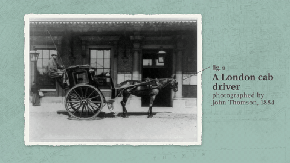

# Specimen interview



A person in a deckle-edged print on their own paper colour, with a specimen label on a leader: fig., name, role.

**Use it for:** an interview or a person's first appearance. **Section:** A person. **Recipe:** `SpecimenInterview` (props and events: [doc 14 §3](../../docs/style-guide/14-production-pipeline.md)).

## Wireframe

The layout at a glance (what Claude shows in a question's preview before anything is rendered):

```text
+--------------------------------------+
|  .--------------------.              |
|  |                    |   fig. a     |
|  |   interview clip   |---A London   |
|  |   or portrait      |   cab driver |
|  '--------------------'   photograph-|
|   deckle print, paper colour         |
+--------------------------------------+
```

## Prompt

Fill in the `{…}` parts and add the line to your video request (see [the starters](../starters/)), or send it on its
own inside a project you already have ("add this to the third section: …").

```text
[block: specimen-interview] {NAME}, {ROLE}, in a deckle-edged print on {pink | mint} paper{, from INTERVIEW CLIP | PORTRAIT}, labelled "fig. {a}".
```

## The prompt behind the preview

```text
[block: specimen-interview] A London cab driver, photographed by John Thomson in 1884, in a deckle-edged print on mint paper, labelled "fig. a".
```

The narration it was built on (`video-projects/example-cab-brain/script.md`):

> On average, learning them takes about three years.

## What the agent builds

Scene `driver` of `video-projects/example-cab-brain/storyboard.json`, as the agent wrote it (kept in step by
`tools/py tools/examples/make_gallery.py`):

<!-- scene-json -->
```json
{
 "id": "driver",
 "recipe": "SpecimenInterview",
 "start": {
  "word": "On"
 },
 "props": {
  "src": "kit:assets/library/photos/transport/photo-london-cab-driver-thomson-1884.jpg",
  "fig": "fig. a",
  "name": "A London cab driver",
  "roles": [
   "photographed by",
   "John Thomson, 1884"
  ],
  "ground": "mint",
  "grade": "bw",
  "watermark": "kit:assets/library/maps/cities/map-london-temple-ordnance-1890s.jpg"
 },
 "note": "block specimen-interview; slot=context claim=fact (RESEARCH 2)"
}
```
<!-- /scene-json -->

## Agent notes

How Claude turns `[block: specimen-interview]` into a scene (the `vox-video` skill reads this section):

- **Facts:** a real name and role from `RESEARCH.md`, and a picture of that person. A historical photograph of an unnamed person gets a description instead of a name.
- **Storyboard:** `src` (a clip or a still), `fig`, `name`, `roles[]`, `ground` (one colour per person), `watermark` (a faint map or engraving), `grade` ("bw" or "native"), `startFromSec`. The label is there from the first frame (as measured); event `label` delays it.
- **Sound:** this recipe draws the picture only; an interview's own sound goes in the storyboard's audio plan.
- **Look:** drawn for `voxScrapbook` (set `"look": "voxScrapbook"` in the storyboard; it brings the `scrapbook` timing profile: phrase cuts lead by 6 f, transitions keep their sounds). Measured on a Vox brand piece: `analysis/vox-sample/vox_braintravel.md`.
