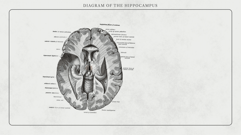

# Specimen plate



A white plate titled "DIAGRAM OF …": the specimen tumbles in over a disc, a magnifier opens onto a detail, and "fig." labels arrive on leaders.

**Use it for:** pointing at one part of a thing: an organ, a machine, a building, a map. **Section:** Evidence: a diagram. **Recipe:** `SpecimenPlate` (props and events: [doc 14 §3](../../docs/style-guide/14-production-pipeline.md)).

## Wireframe

The layout at a glance (what Claude shows in a question's preview before anything is rendered):

```text
+--------------------------------------+
|     DIAGRAM OF THE HIPPOCAMPUS       |
| .----------------------------------. |
| |   .-------.          .--------.  | |
| |  ( engrav(o)---------( detail ) |  |
| |   '-------'           '--------'  ||
| |                fig. b  Posterior | |
| '----------------------------------' |
+--------------------------------------+
```

## Prompt

Fill in the `{…}` parts and add the line to your video request (see [the starters](../starters/)), or send it on its
own inside a project you already have ("add this to the third section: …").

```text
[block: specimen-plate] A plate titled "DIAGRAM OF {SUBJECT}": {ENGRAVING} in the middle, a magnifier on {DETAIL}, labelled "{LABEL}"{; on "WORD" the label changes to "NEW LABEL"}.
```

## The prompt behind the preview

```text
[block: specimen-plate] A plate titled "DIAGRAM OF THE HIPPOCAMPUS": a 1909 brain section in the middle, a magnifier on the posterior hippocampus, labelled "larger in cab drivers"; on "longer" the label changes to "larger with every year at the wheel".
```

The narration it was built on (`video-projects/example-cab-brain/script.md`):

> The back of the drivers' hippocampus, a region for memory and navigation, was larger. And the longer they had driven, the larger it was.

## What the agent builds

Scene `plate` of `video-projects/example-cab-brain/storyboard.json`, as the agent wrote it (kept in step by
`tools/py tools/examples/make_gallery.py`):

<!-- scene-json -->
```json
{
 "id": "plate",
 "recipe": "SpecimenPlate",
 "start": {
  "word": "The",
  "nth": 3
 },
 "transitionIn": {
  "kind": "paperSlide",
  "variant": "in",
  "corner": "br",
  "sfx": false
 },
 "props": {
  "title": "DIAGRAM OF THE HIPPOCAMPUS",
  "subject": {
   "src": "kit:assets/library/engravings/anatomy/engr-brain-horizontal-section-sobotta-1909.jpg",
   "x": 330,
   "y": 170,
   "w": 760,
   "h": 752
  },
  "magnifier": {
   "x": 591,
   "y": 701,
   "r": 40,
   "bx": 1460,
   "by": 400,
   "br": 220,
   "zoom": 2.4
  },
  "labels": [
   {
    "fig": "fig. b",
    "lines": [
     "Posterior hippocampus",
     "larger in cab drivers"
    ],
    "x": 1250,
    "y": 700,
    "from": {
     "x": 632,
     "y": 708
    },
    "width": 560
   }
  ],
  "swap": {
   "labels": [
    [
     "Posterior hippocampus",
     "larger with every",
     "year at the wheel"
    ]
   ]
  },
  "source": "Maguire et al., PNAS, 2000 · plate: Sobotta, 1909"
 },
 "events": [
  {
   "id": "magnifier",
   "at": {
    "word": "hippocampus",
    "kind": "object"
   }
  },
  {
   "id": "label0",
   "at": {
    "word": "larger",
    "kind": "object"
   }
  },
  {
   "id": "swap",
   "at": {
    "word": "longer",
    "kind": "object"
   }
  }
 ],
 "note": "block specimen-plate; slot=evidence claim=fact (RESEARCH 3, 4, 7)"
}
```
<!-- /scene-json -->

## Agent notes

How Claude turns `[block: specimen-plate]` into a scene (the `vox-video` skill reads this section):

- **Coordinates:** give `subject` x, y, w, h in the image's own aspect (the magnifier relies on it). The magnifier ring sits on the detail (design px = subject.x + image_x × w / image_width); the big circle (`bx`, `by`, `br`) in free space, usually upper right; labels below it with `from` on the detail.
- **Storyboard:** `title`, `subject`, `backdrop` (a disc behind; false for none), `magnifier`, `labels[]` (`fig`, `lines`, `x`, `y`, `from`), `swap` (`subject` and/or `labels` change on event `swap`), `source`. Events `magnifier` on the part's name, `label0…3`, `swap`.
- **Assets:** anatomical and technical engravings: `search.py <subject> --kind engravings` (Sobotta 1909, Gray's 1918, encyclopaedia plates).
- **Look:** drawn for `voxScrapbook` (set `"look": "voxScrapbook"` in the storyboard; it brings the `scrapbook` timing profile: phrase cuts lead by 6 f, transitions keep their sounds). Measured on a Vox brand piece: `analysis/vox-sample/vox_braintravel.md`.
