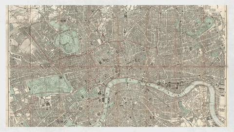

# Torn-paper stat



Three paper scraps slide in: the number on a white scrap, the context on a grey strip, the payoff in condensed caps on kraft.

**Use it for:** a number that needs its context and a takeaway. **Section:** A number. **Recipe:** `PaperStat` (props and events: [doc 14 §3](../../docs/style-guide/14-production-pipeline.md)).

## Wireframe

The layout at a glance (what Claude shows in a question's preview before anything is rendered):

```text
+--------------------------------------+
| .--------------.                     |
| | 79           |  .----------------. |
| | trainees     |  | FROM THE START | |
| '--------------'  '----------------' |
|   .------------------------------.   |
|   | followed through the Knowledge|  |
+--------------------------------------+
```

## Prompt

Fill in the `{…}` parts and add the line to your video request (see [the starters](../starters/)), or send it on its
own inside a project you already have ("add this to the third section: …").

```text
[block: torn-paper-stat] {NUMBER} {UNIT} on a paper scrap, "{CONTEXT}" on a grey strip, "{PAYOFF}" on kraft{, over a picture of SUBJECT | over COLOUR paper}.
```

## The prompt behind the preview

```text
[block: torn-paper-stat] 25,000 streets on a paper scrap, "within six miles of Charing Cross" on a grey strip, "BY HEART" on kraft, over an 1890 map of London.
```

The narration it was built on (`video-projects/example-cab-brain/script.md`):

> It covers about twenty-five thousand streets, all within six miles of Charing Cross.

## What the agent builds

Scene `trainees` of `video-projects/example-cab-brain/storyboard.json`, as the agent wrote it (kept in step by
`tools/py tools/examples/make_gallery.py`):

<!-- scene-json -->
```json
{
 "id": "streets",
 "recipe": "PaperStat",
 "start": {
  "word": "It"
 },
 "transitionIn": {
  "kind": "paperSlide",
  "variant": "in",
  "corner": "bl"
 },
 "props": {
  "value": "25,000",
  "unit": "streets",
  "context": "within six miles of Charing Cross",
  "payoff": "BY HEART",
  "image": "kit:assets/library/maps/cities/map-london-bacon-1890.jpg"
 },
 "events": [
  {
   "id": "value",
   "at": {
    "word": "twenty-five",
    "kind": "object"
   }
  },
  {
   "id": "context",
   "at": {
    "word": "within",
    "kind": "object"
   }
  },
  {
   "id": "payoff",
   "at": {
    "word": "miles",
    "kind": "object"
   }
  }
 ],
 "note": "block torn-paper-stat; slot=context claim=number (RESEARCH 1)"
}
```
<!-- /scene-json -->

## Agent notes

How Claude turns `[block: torn-paper-stat]` into a scene (the `vox-video` skill reads this section):

- **Facts:** the number and the context come from `RESEARCH.md`. The payoff may be unspoken (the reference shows it before the word) but it must still be true.
- **Storyboard:** `value` (as it reads: "25,000"), `unit`, `context`, `payoff` (caps), `image` (a full-frame picture in a paper mat, e.g. a map) or `ground`, `source`. Events `value` on the number's first word, `context`, `payoff` (kind `object`). Long lines shrink to fit one line.
- **Look:** drawn for `voxScrapbook` (set `"look": "voxScrapbook"` in the storyboard; it brings the `scrapbook` timing profile: phrase cuts lead by 6 f, transitions keep their sounds). Measured on a Vox brand piece: `analysis/vox-sample/vox_braintravel.md`.
