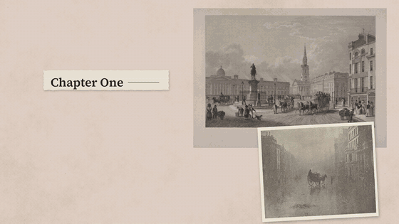

# Starter: How learning London changes a cab driver's brain



A 49-second explainer in the **scrapbook look** (`voxScrapbook`): watercolour paper in one colour per chapter, torn
scraps, old engravings and "fig." specimen labels. It is built from the seven [scrapbook blocks](../README.md#the-scrapbook-collection).
Paste the prompt into Claude Code: with the [plugin](../../GETTING_STARTED.md) installed, or inside a checkout of this
repository. To make your own video, keep the block lines and change the topic and the details.

The look was measured frame by frame on a Vox brand piece ([the analysis](../../analysis/vox-sample/vox_braintravel.md)).
The blocks re-create its devices with free-licence pictures and the kit's own sounds: nothing in this repository is cut
from that video.

## The prompt

```text
Make a 45-second Vox-style explainer: "How learning London changes a cab driver's brain".
Look: voxScrapbook. Pictures from the shared free-licence catalog (old engravings, maps and photographs), a light
music bed, a stamp thud on the count and a chime at the end.
Build it from these blocks, in order:
1. Chapter one: [block: torn-paper-chapter-card] Chapter One: "The test" on pink paper, with an engraving of Charing Cross and an 1890s London street photo.
2. The size of it: [block: torn-paper-stat] the number of streets, "within six miles of Charing Cross", "BY HEART", over an 1890 map of London. It arrives with [block: paper-sheet-slide] from the bottom-left.
3. The drivers: [block: specimen-interview] a London cab driver photographed by John Thomson in 1884, on mint paper.
4. Chapter two: [block: torn-paper-chapter-card] Chapter Two: "The scan" on blue paper.
5. The study: [block: stamped-stat] stamp how many drivers were scanned, in purple.
6. The finding: [block: specimen-plate] "DIAGRAM OF THE HIPPOCAMPUS"; magnify the part that differed; the label changes when the narration says how it grew with the years.
7. Chapter three: [block: torn-paper-chapter-card] Chapter Three: "The proof" on coral paper.
8. The follow-up: [block: torn-paper-stat] how many trainees the 2011 study followed, "FROM THE START".
9. The answer: [block: specimen-comparison] fig. c "Qualified" against fig. d "Did not qualify". The stat leaves with [block: paper-sheet-slide] out to the top-right.
10. Ending: [block: torn-paper-chapter-card] as an end card: "Learning a city", kicker "A KIT EXAMPLE".
```

The prompt names the subjects, not the numbers: Claude finds the numbers (25,000 streets, 16 drivers, 79 trainees)
in the sources and records them in `RESEARCH.md`, as it does for every fact.

## What happens next

1. Claude checks the installation, then researches the topic and writes `RESEARCH.md`: a source for every fact.
2. It writes the script, one section per block, and **stops to show it to you**. Change anything, then say go.
3. It makes a scratch voice-over, takes pictures and music from the free catalog, and writes the storyboard: one scene
   per block.
4. It renders a draft (`out/studio/<slug>.mp4`) and writes a recording guide, so you can record the voice yourself.

Your run will not match this page word for word: the research, the wording and the pictures can differ. The blocks fix
the structure, and the facts always come from the research.

## The result in this repository

[`video-projects/example-cab-brain/`](../../video-projects/example-cab-brain/): the script, `RESEARCH.md`,
`storyboard.json` and `CREDITS.md`. Build and render it yourself with
`tools/py tools/examples/build_example.py example-cab-brain`.

| Section | Block | Scene in the storyboard |
|---|---|---|
| Chapter one | [torn-paper-chapter-card](../blocks/torn-paper-chapter-card.md) | `ch1` |
| The size of it | [torn-paper-stat](../blocks/torn-paper-stat.md), arriving on a [paper-sheet-slide](../blocks/paper-sheet-slide.md) | `streets` |
| The drivers | [specimen-interview](../blocks/specimen-interview.md) | `driver` |
| Chapter two | [torn-paper-chapter-card](../blocks/torn-paper-chapter-card.md) | `ch2` |
| The study | [stamped-stat](../blocks/stamped-stat.md) | `sixteen` |
| The finding | [specimen-plate](../blocks/specimen-plate.md) | `plate` |
| Chapter three | [torn-paper-chapter-card](../blocks/torn-paper-chapter-card.md) | `ch3` |
| The follow-up | [torn-paper-stat](../blocks/torn-paper-stat.md) | `trainees` |
| The answer | [specimen-comparison](../blocks/specimen-comparison.md), after a [paper-sheet-slide](../blocks/paper-sheet-slide.md) out | `compare` |
| Ending | [torn-paper-chapter-card](../blocks/torn-paper-chapter-card.md) (kicker, no number) | `end` |
