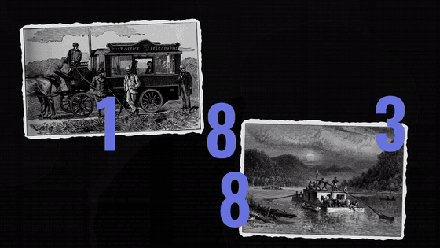

# Starter: Why railroads gave America time zones



A 30-second explainer built from five [blocks](../blocks/). Paste the prompt into Claude Code: with the
[plugin](../../GETTING_STARTED.md) installed, or inside a checkout of this repository. To make your own video, keep
the block lines and change the topic and the details.

## The prompt

```text
Make a 30-second Vox-style explainer: "Why railroads gave America time zones".
Look: voxEarworm. Pictures from the shared free-licence catalog, a calm music bed, one page-flip sound.
Build it from these blocks, in order:
1. Hook: [block: cold-open-year] 1883, the United States; two archival pictures (a telegraph van, a river flatboat).
2. The problem: [block: keyword-cut] NOON over a busy street photo, with "NEW YORK · PHILADELPHIA" under it.
3. The number: [block: giant-word-card] "56 TIMES" with a small locomotive photo.
4. The change: [block: map-route] the US time zones; route New York → Chicago → Denver → San Francisco; label "4 ZONES", "NOV 18 · 1883".
5. The world: [block: keyword-cut] GREENWICH over the Earth from space, with "WASHINGTON · 1884" under it.
6. The law: [block: giant-word-card] "1918".
7. Ending: [block: end-card] our series "TIME DESK", tagline "A KIT EXAMPLE".
```

## What happens next

1. Claude checks the installation, then researches the topic and writes `RESEARCH.md`: a source for every fact.
2. It writes the script, one section per block, and **stops to show it to you**. Change anything, then say go.
3. It makes a scratch voice-over, takes pictures and music from the free catalog, and writes the storyboard: one scene
   per block.
4. It renders a draft (`out/studio/<slug>.mp4`) and writes a recording guide, so you can record the voice yourself.

Your run will not match this page word for word: the research, the wording and the pictures can differ. The blocks fix
the structure, and the facts always come from the research.

## The result in this repository

[`video-projects/example-time-zones/`](../../video-projects/example-time-zones/): the script, `RESEARCH.md`,
`storyboard.json` and `CREDITS.md`. Build and render it yourself with `npm run example`.

| Section | Block | Scene in the storyboard |
|---|---|---|
| Hook | [cold-open-year](../blocks/cold-open-year.md) | `open` |
| The problem | [keyword-cut](../blocks/keyword-cut.md) | `noon` |
| The number | [giant-word-card](../blocks/giant-word-card.md) | `railroads` |
| The change | [map-route](../blocks/map-route.md) | `zones` |
| The world | [keyword-cut](../blocks/keyword-cut.md) | `greenwich` |
| The law | [giant-word-card](../blocks/giant-word-card.md) | `law` |
| Ending | [end-card](../blocks/end-card.md) | `end` |
