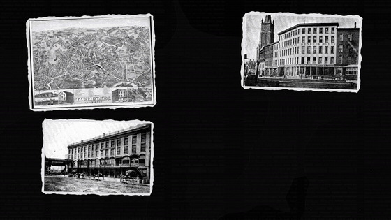

# Starter: How the world agreed on time



A 39-second explainer that uses ten different [blocks](../blocks/), one per section: a photo collage, the series
ident, a montage, a name card, a counter, a document, a quotation, a bar chart, footage and the end card. Most of the
block previews in the gallery are cut from it.

## The prompt

```text
Make a 40-second Vox-style explainer: "How the world agreed on time".
Look: voxEarworm. Pictures and footage from the shared free-licence catalog, a calm music bed.
Build it from these blocks, in order:
1. Hook: [block: photo-collage] three pictures of American towns from the 1870s and a sundial engraving; the words "SUN TIME" pop on "sun". End on the question of how the whole world ended up on one clock.
2. Series ident: [block: series-ident] our series "Time Desk" with the tagline "How the world agreed on time", card style, right after the question.
3. Context: [block: montage-crane] railroads → a locomotive cut-out, telegraph → a telegraph van cut-out, continent → a railroad map; label each.
4. The person: [block: name-card] Sandford Fleming, chief engineer of the Canadian Pacific Survey, with his 1895 portrait.
5. The plan: [block: data-counter] count up to 24 with the label "TIME ZONES · ONE PER HOUR" and ring it.
6. The evidence: [block: document-highlight] the 1883 standard railway time map; highlight its title on "adopted" and ring the four zone clocks as they are named.
7. The decision: [block: quote-card] the 1884 resolution's words "…to adopt a single prime meridian for all nations…", credited to the International Meridian Conference, 1884.
8. The vote: [block: data-bars] for 22, against 1, abstained 2, titled "THE GREENWICH VOTE · 1884".
9. Today: [block: footage-clip] NASA footage of Earth from the space station, silent, with a "TODAY" date tag.
10. Ending: [block: end-card] our series "TIME DESK", tagline "A BLOCK GALLERY".
```

## What happens next

The same as for [the first starter](time-zones.md#what-happens-next): research with sources, a script to approve, a
scratch voice-over, catalog pictures and music, a storyboard with one scene per block, a draft render and a recording
guide.

For this one the research also settled what NOT to say: sources disagree on how many nations and delegates came to the
1884 conference, so the script gives no count (`RESEARCH.md`, last line).

## The result in this repository

[`video-projects/example-world-time/`](../../video-projects/example-world-time/). Build and render it with
`tools/py tools/examples/build_example.py example-world-time`.

| Section | Block | Scene in the storyboard |
|---|---|---|
| Hook | [photo-collage](../blocks/photo-collage.md) | `collage` |
| Series ident | [series-ident](../blocks/series-ident.md) | `ident` |
| Context | [montage-crane](../blocks/montage-crane.md) | `montage` |
| The person | [name-card](../blocks/name-card.md) | `fleming` |
| The plan | [data-counter](../blocks/data-counter.md) | `plan` |
| The evidence | [document-highlight](../blocks/document-highlight.md) | `map1883` |
| The decision | [quote-card](../blocks/quote-card.md) | `resolution` |
| The vote | [data-bars](../blocks/data-bars.md) | `vote` |
| Today | [footage-clip](../blocks/footage-clip.md) | `today` |
| Ending | [end-card](../blocks/end-card.md) | `end` |
